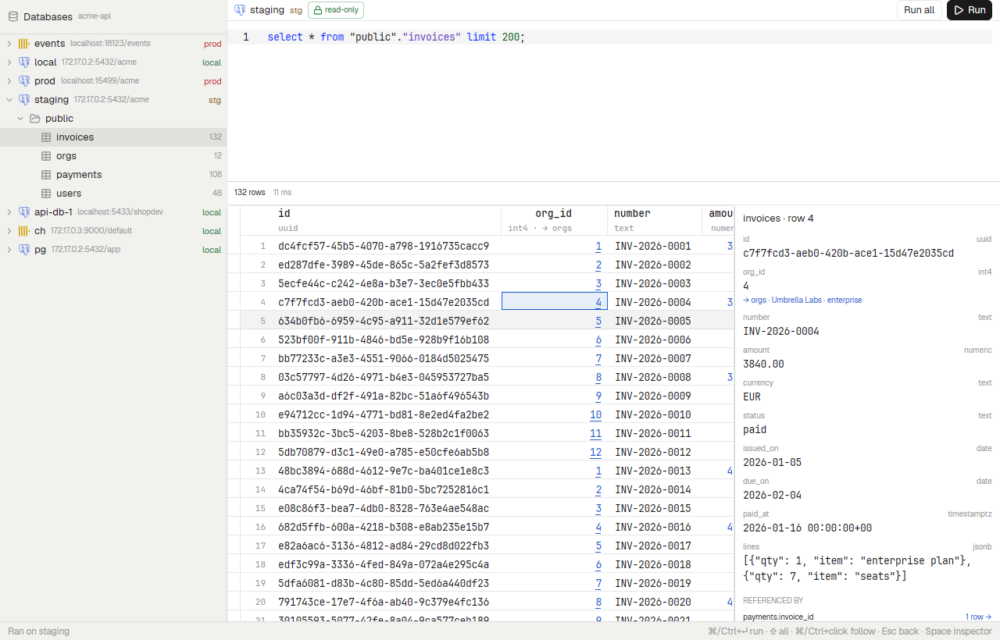

# furet-app



furet's database explorer as its own native window, for when you're not in herdr. Built on
[GPUI](https://gpui.rs) (Zed's GPU UI framework) with [gpui-kit](https://gpui-kit.com): no webview, no
JavaScript runtime.

```sh
cargo install --locked --git https://github.com/gaspb/furet furet-app
furet-app ~/src/my-api      # the repo whose connections to show (default: the current folder)
```

It needs `furet` on the PATH (or `FURET_BIN`): it talks to the same `furet serve` engine as the CLI and the herdr
panel, so connections, tunnels, read-only rules and the history are the same everywhere.

- It looks like the herdr panel: herdr's "paper" and "graphite" palettes (following the system's light or dark mode),
  Geist and JetBrains Mono, which the app carries.
- The tree: connections (Postgres or ClickHouse, endpoint, stage), then schemas and tables with their size. Opening a
  connection connects.
- The toolbar: the connection, its stage, and **read-only** or **read-write**. Click that to switch; on prod you type
  the connection's name first. **Run** and **Run all**.
- Above the results: rows and time, or the error with its detail and hint.
- A table in the tree shows its first 200 rows.
- The SQL editor (tree-sitter highlighting): Cmd/Ctrl+Enter runs the statement under the cursor, Cmd/Ctrl+Shift+Enter
  everything.
- Results in a virtualized table: values coloured by type, null in italics, foreign keys underlined, each column's
  type (and what a foreign key points at) under its name.

- Following rows, as in the panel:
  - Hovering a foreign-key value shows the row it points at in a few words.
  - Cmd/Ctrl+click it, double-click it, or Cmd/Ctrl+Enter on it, opens that row.
  - A trail above the results leads back (Esc goes back one step), and **As SQL** puts the step in the editor.
  - Columns without a constraint are matched by name (`→ tenants?`).
- The inspector beside the results (Space) shows the selected row, where its keys point, and what points at it, with
  counts. Click any of them to go there.

Not here yet, compared with the herdr panel: history, Ask agent, copying rows and schema drift.

Not in the release yet (it's a heavy build): `cargo build -p furet-app`, or the install line above. Linux needs the usual
GPUI libraries (X11 or Wayland, Vulkan, fontconfig).
